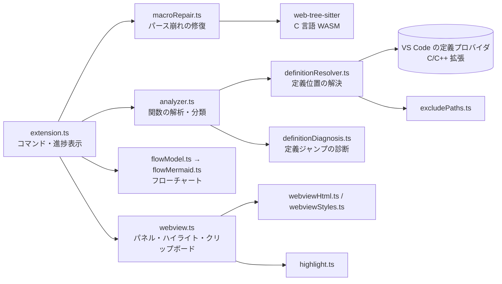
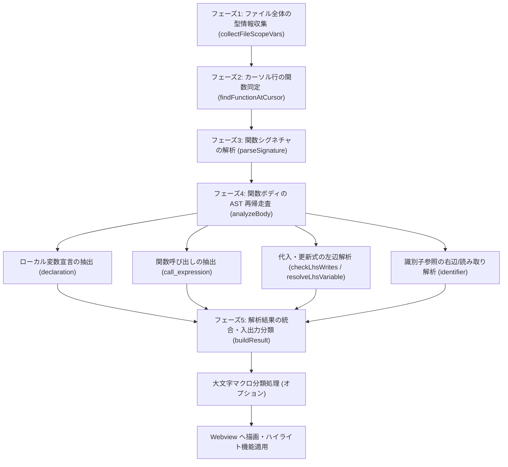
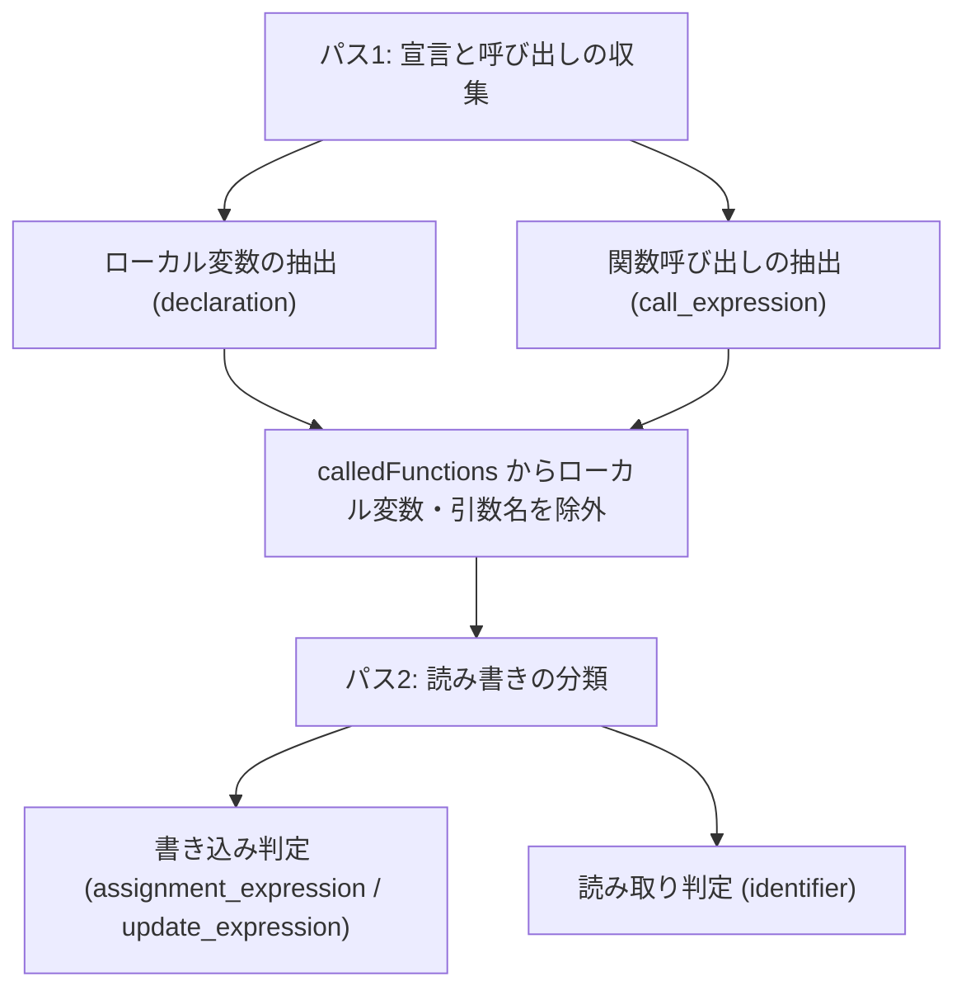
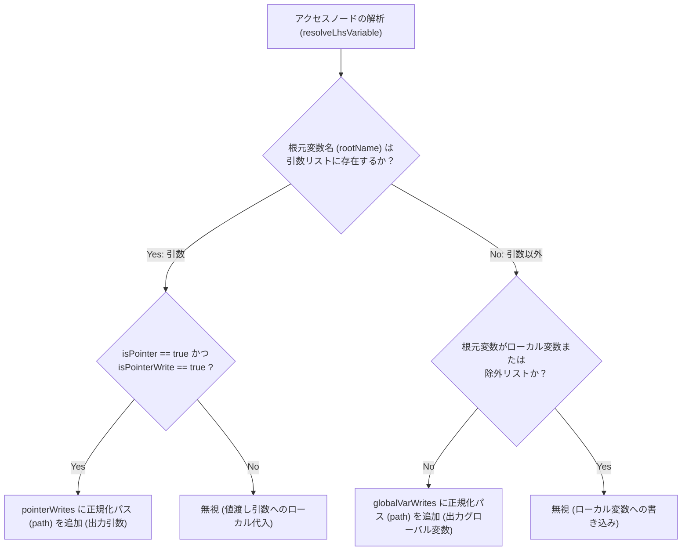
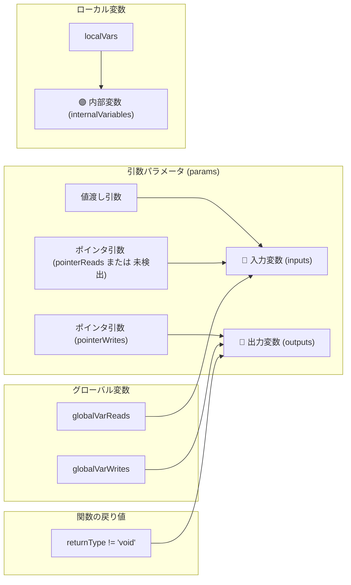
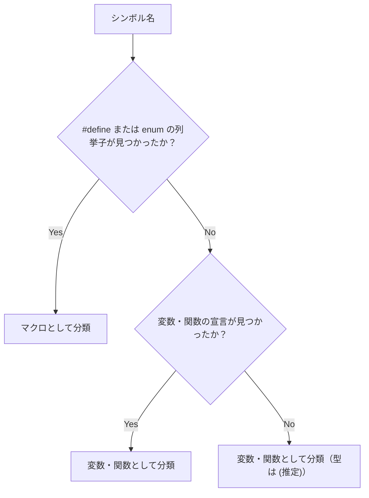

# 設計

## 全体構成



## ディレクトリ構成と各モジュールの責務

| パス | 責務 |
|---|---|
| `src/extension.ts` | 起動、コマンド（解析・診断・フローチャート）の登録、進捗表示、パーサーの初期化 |
| `src/analyzer.ts` | 関数の解析と分類（下記「解析処理の詳細」のフェーズ1〜5） |
| `src/macroRepair.ts` | 修飾子マクロによるパース崩れの修復（フェーズ0） |
| `src/definitionResolver.ts` | 定義プロバイダで定義位置を求め、型名・コメント・定義値を読み取る |
| `src/excludePaths.ts` | 定義位置の候補を `excludePaths` で絞り込む |
| `src/definitionDiagnosis.ts` | 定義ジャンプがうまくいかない原因の判定 |
| `src/flowModel.ts`、`src/flowMermaid.ts` | 関数の制御構造のモデル化と、Mermaid のテキストの生成 |
| `src/webview.ts` | 解析結果のパネルの管理、エディタのハイライト、クリップボード |
| `src/webviewHtml.ts`、`src/webviewStyles.ts` | Webview の HTML とスタイル（VS Code API に依存しない） |
| `src/highlight.ts` | ハイライト検索用の正規表現の生成 |
| `scripts/copy-wasm.js` | ビルド時に WASM をコピーする |
| `test/` | `node:test` によるテスト（`test/support/` は共通の補助） |
| `samples/` | 動作確認用のサンプル（3階層のインクルード） |

## データの流れ

1. ソースをパースし、修飾子マクロによるパース崩れを修復する（フェーズ0）。
2. ファイルスコープの型情報（構造体、関数、typedef、マクロ、enum、コメント、型名）を集める（フェーズ1）。
3. カーソル位置の関数を特定し（フェーズ2）、シグネチャ（フェーズ3）とボディ（フェーズ4）を解析して、入出力などに分類する（フェーズ5）。
4. 参照位置で定義プロバイダを呼び、定義位置から型名・コメント・定義値を補う（フェーズ6）。あわせて定義ジャンプの診断を行う。
5. Webview に描画する。

各フェーズの詳細は、下記「解析処理の詳細」を参照。設計判断は [ADR](adr/README.md) を参照。

## 外部依存

| 依存 | 用途 |
|---|---|
| `web-tree-sitter`（`0.20.8`。実行時の唯一の依存） | C ソースの構文解析（[ADR 0002](adr/0002-use-tree-sitter.md)） |
| `tree-sitter-wasms`（開発用） | C 言語パーサーの WASM の供給元（`scripts/copy-wasm.js` でコピー） |
| VS Code の定義プロバイダ（C/C++ 拡張） | 定義位置の解決（[ADR 0003](adr/0003-definition-via-vscode-provider.md)） |
| 開発用: TypeScript、esbuild、`@types/vscode`、`@types/node` | ビルドと型 |

## 解析処理の詳細

解析の各フェーズで、何をどう判定しているかを説明する。判定の結果として利用者に見える規則は [spec.md](spec.md) にある。

### 解析の全体フロー



#### 実装との対応

各フェーズは `src/analyzer.ts` の同名関数に1対1で対応しており、`analyzeCFunction` はこれらを順に呼び出すだけの薄い関数である。

| フェーズ | 関数名 |
|---|---|
| 0 | `parseWithModifierMacroRepair`（`src/macroRepair.ts`、パース時に適用） |
| 1 | `collectFileScopeSymbols`（現在のファイルのみ） |
| 2 | `findFunctionAtCursor` |
| 3 | `parseSignature` |
| 4 | `analyzeBody` |
| 5 | `buildResult` |
| 6 | `resolveDefinitions`（`definitionResolver.ts`。定義位置から型名・コメントを補う） |


### フェーズ 0: 修飾子マクロによるパース崩れの修復 (`macroRepair.ts`)

解析に入る前に、ソースのパース結果を必要に応じて修復する。解析対象ファイルと、定義位置の解決で読み込むファイルの双方に適用する（いずれも `extension.ts` から呼び出す）。

#### 問題

組み込み系のCコードでは、記憶域クラスをマクロで隠す記法が広く使われる。

```c
#define GLOBAL extern
GLOBAL BYTE hoge;
```

tree-sitter はプリプロセッサを展開しないため、`GLOBAL` を型名と解釈し、本来の型である `BYTE` を ERROR ノードへ追いやる。

```
declaration
  type_identifier  |GLOBAL|      ← 型名として扱われる
  ERROR
    identifier     |BYTE|        ← 本来の型が捨てられる
  identifier       |hoge|
```

その結果、型名が `GLOBAL` と表示され、さらに `BYTE` がグローバル変数として誤検出される。

#### 修復方式

崩れ方は記法ごとに大きく異なり（ポインタ・配列・初期化子・`unsigned` の有無などで7通り以上のAST形状になる）、崩れたASTを個別に補正するのは現実的ではない。そのため、**先頭のマクロ部分を同じ長さの空白へ置き換えて再パースする**方式を採る。

```c
GLOBAL BYTE hoge;   →   "      BYTE hoge;"
```

文字数が変わらないため、行・列・オフセットはすべて元のソースと一致する。定義位置ジャンプやハイライトなど、下流の処理は一切変更不要である。

#### 修復対象の判定

修復は3段階に分かれる。崩れ方によって、パースエラーが出る場合と出ない場合があるためである。

##### 段階1: 型名へ吸収されたマクロ (`collectAbsorbedMacroSpans`)

`VOLATILE unsigned long status;` は**エラーなくパースされ**、型名が `VOLATILE unsigned long` になる。

```
sized_type_specifier  |VOLATILE unsigned long|
  type_identifier     |VOLATILE|      ← 型名の一部として扱われる
  unsigned            |unsigned|
  long                |long|
```

C言語では `unsigned` などの前に素の識別子が来ることはないため、**`sized_type_specifier` の先頭が `type_identifier` である形は必ず修飾子マクロ**である。エラーの有無によらず対象とする。

##### 段階2: メモリモデル修飾子 (`collectMemoryModelQualifierSpans`)

16ビット環境のコンパイラの拡張キーワード `far` / `near` / `huge`（`_far` / `__far` などの表記を含む）は、tree-sitter では素の識別子として扱われ、`void far func(void)` では `far` が ERROR ノードに、`far void func(void)` では `far` が型名に、本来の型が ERROR ノードになる。

これらの識別子のうち、ERROR ノードの直下にあるもの、または宣言（`declaration` / `function_definition` / `field_declaration` / `parameter_declaration`）のボディ外にエラーがある場合のものを空白化する。`int far = 0;` のように変数名として正しく使われている `far` は対象外である。

段階3より先に行うのは、`BYTE far func(void)` で段階3が型名の `BYTE` を修飾子マクロと誤認して空白化するのを防ぐためである。

##### 段階3: パースが崩れたマクロ (`collectModifierMacroSpans`)

以下をすべて満たす `declaration` / `function_definition` / `field_declaration` の先頭トークンを対象とする。

| 条件 | 理由 |
|---|---|
| 先頭の子が `type_identifier` または `identifier` | 素の識別子で始まる宣言のみが対象（`int` などのキーワードは別ノード種別） |
| ボディ（`compound_statement`）の外側にエラーまたは欠落トークンがある | `MyType func(void) { 壊れたボディ }` のような正当な型名を誤って除去しないため |

`GLOBAL unsigned char uc;` のように先頭マクロが `sized_type_specifier` へ取り込まれる場合は、その内側の先頭要素を対象とする。

#### 安全策

段階ごとに採用条件が異なる。

| 段階 | 判定の性質 | 採用条件 |
|---|---|---|
| 1 | 構文的に確実 | エラー数が**増えない**こと |
| 2・3 | 推定を含む | エラー数が**実際に減る**こと |

誤検出により解析結果が悪化することはなく、正常なコードや本当に構文エラーがあるコードはそのまま扱われる。また、空白化するのは検出した箇所のみのため、`#define GLOBAL extern` の記述自体は影響を受けない。

#### 対応する記法

| 記法 | 修復後の型名 |
|---|---|
| `GLOBAL BYTE hoge;` | `BYTE` |
| `GLOBAL BYTE *phoge;` | `BYTE` |
| `GLOBAL BYTE arr[10];` | `BYTE` |
| `GLOBAL BYTE hoge = 0;` | `BYTE` |
| `GLOBAL unsigned char uc;` | `unsigned char` |
| `GLOBAL const BYTE cb;` | `BYTE` |
| `GLOBAL struct Foo st;` | `struct Foo` |
| `GLOBAL BYTE a, b;` | `BYTE` |
| `GLOBAL S16 hal_read(void);` | `S16`（呼び出し関数の戻り値型） |
| `VOLATILE unsigned long status;` | `unsigned long`（段階1で修復） |
| `void far func(void) { ... }` | `void`（段階2で修復） |
| `char far *p;` | `char`（段階2で修復） |

関数定義（`GLOBAL void func(void) { ... }`）、関数内のローカル宣言（`LOCAL BYTE tmp;`）、構造体メンバ（`VOLATILE int hw_reg;`）も対象である。


### フェーズ 1: ファイルスコープ（グローバル）型情報の収集

関数解析に先立ち、ファイル全体の AST ルートノードから直下の `declaration`（変数宣言）をスキャンし、グローバル変数の名前と型のマッピング（`fileScopeVars`）を作成する。

```c
int global_counter = 0;              // name: "global_counter", type: "int"
struct Config global_cfg;            // name: "global_cfg", type: "struct Config"
struct Data { int x; } global_data;  // name: "global_data", type: "struct Data" (インライン定義のクレンジング後)
int (*handler)(int);                 // name: "handler",     type: "int*"       (関数ポインタ変数)
int prototype(int);                  // 関数プロトタイプ宣言のため登録されない
```

- **型名クレンジング** (`cleanTypeText`): `struct Data { ... }` のようなインライン構造体定義が含まれる場合、`{` より前の型名部分（`struct Data`）のみを取り出して型として記録する。改行や連続する空白も単一の空白へ正規化する。この処理は**ファイルスコープ・ローカル変数の双方に適用**される。
- **関数プロトタイプ宣言の除外**: 宣言が `function_declarator` を経由する場合、それが変数宣言か関数プロトタイプかを**ポインタ深さ (`pointerDepth`) で判別**する。
  - `int prototype(int);` → `pointerDepth == 0` のため**変数ではない**と判定し、登録しない。
  - `int (*handler)(int);` → `pointerDepth == 1`（`parenthesized_declarator` 内の `pointer_declarator` を経由）のため**関数ポインタ変数**として登録する。

なお、変数宣言のスキャン処理（`collectDeclaredVars`）はファイルスコープとローカル変数で共通化されており、カンマ区切りの複数宣言・初期化子付き宣言・配列・多重ポインタ・関数ポインタ宣言に対応する。

#### 配列の次元の表記ルール

配列の次元は**名前と型名のどちらか一方にのみ**表示する。両方に出すと冗長になるためである。

| 条件 | 次元の表示先 | 例 |
|---|---|---|
| 添字でアクセスされている | **名前**（アクセスパス） | 名前 `hoge[N]` / 型 `int` |
| 添字なしで参照されている | **型名** | 名前 `table` / 型 `int[8]` |
| 内部変数（名前は宣言名そのもの） | **型名** | 名前 `local_arr` / 型 `int[5]` |

##### 構造体メンバの型解決 (`resolveAccessPath`)

アクセスパスを区切り文字（`.` と `->`）で分割し、構造体定義を辿って**最終的に参照しているメンバの型**を決定する。

```
var_ptr->sub.member
  ↓ 根元 var_ptr の型 = struct Outer*
  ↓ ポインタ表記を除去 → struct Outer
  ↓ struct Outer のメンバ sub の型 = struct Sub
  ↓ struct Sub のメンバ member の型 = int
  → 表示する型 = int
```

| アクセスパス | 宣言 | 表示される型 |
|---|---|---|
| `tbl[5].id` | `HogeStruct tbl[5]` | `int` |
| `var_ptr->sub.member` | `struct Outer *var_ptr` | `int` |
| `cfg.name[8]` | `char name[8]` | `char` |
| `cfg.name`（添字なし） | `char name[8]` | `char[8]` |
| `cfg.ptr` | `int *ptr` | `int*` |

解決できたメンバは、**型だけでなく定義位置もそのメンバのもの**になる。「定義へ」ボタンは構造体変数の宣言ではなく、メンバの宣言行（インクルード先のヘッダを含む）へジャンプする。

構造体定義やメンバが見つからない場合は、根元の型で代用せず**型を `(推定)`、定義位置を未設定**にする。誤った型や無関係な場所へのジャンプを提示するより、解決できていないことを明示する方が誤解を招かないためである。

| 状況 | 型 | 定義位置 |
|---|---|---|
| メンバまで解決できた | メンバの型 | **メンバの宣言行** |
| メンバが見つからない | `(推定)` | **なし**（ボタンを表示しない） |
| 構造体定義が見つからない | `(推定)` | **なし** |
| メンバを伴わない変数 | 変数の型 | 変数の宣言行 |

ポインタ引数のメンバアクセス（`data->id`）にも同じ解決を適用する。引数そのもの（`*out = 1` の `out`）は従来どおり引数の宣言行を指す。

##### アクセスパスへの次元の反映

添字でアクセスされた変数のアクセスパスは、いったん `[]` に正規化された後、**宣言された次元で置き換え**られる。置き換えは**セグメントごと**に行われ、各セグメントが指す変数・メンバの次元が使われる（`tbl[].id` の `[]` には `tbl` の次元が、`cfg.name[]` の `[]` にはメンバ `name` の次元が入る）。

| 宣言 | コード上の使用 | 表示される名前 |
|---|---|---|
| `int hoge[N];` | `hoge[2]`、`hoge[i]` | `hoge[N]` |
| `int grid[3][4];` | `grid[1][2]` | `grid[3][4]` |
| `HogeStruct tbl[5];` | `tbl[0].id` | `tbl[5].id` |
| `extern int unsized[];` | `unsized[0]` | `unsized[]`（次元が不明） |
| `int *ptr;` | `ptr[0]` | `ptr[]`（配列宣言ではない） |

添字の値（`[2]` と `[i]`）によらず同じ表示名になるため、**同一変数への複数のアクセスは1件に集約**される。

##### 型名の表記

| 宣言 | 型名の表示（添字なし参照・内部変数の場合） |
|---|---|
| `int plain` | `int` |
| `int *ptr` | `int*` |
| `int hoge_array[5]` | `int[5]` |
| `int grid[3][4]` | `int[3][4]` |
| `char buf[]` | `char[]` |
| `char sized[MAX_LEN]` | `char[MAX_LEN]` |
| `int *ptrs[8]` | `int*[8]` |

一方、**引数の配列はポインタ表記（`int*`）**とする。C言語の仕様上、引数の配列はポインタへ減衰するためである。

```c
void f(int param_arr[5])   // 型は int*  （減衰するため）
int  local_arr[5];         // 型は int[5]（減衰しない）
```

##### 名前フィールドは機能的なフィールドである

名前フィールドはハイライト検索の正規表現とコピー対象を兼ねる。そのため、名前に添字を含める場合は `buildHighlightRegex` が**添字の中身によらず任意の添字にマッチ**する必要がある（`hoge[N]` という表示名でコード上の `hoge[2]` を見つけられなければならない）。

同じ理由から、**内部変数の名前には配列の次元を付けない**。内部変数の名前は宣言名そのもの（`hoge_array`）であり、ここに `[]` を付けると `memcpy(dst, hoge_array, n)` や `sizeof(hoge_array)` のような添字を伴わない参照がハイライトから漏れてしまう。

#### ファイルスコープの走査範囲 (`forEachFileScopeNode`)

宣言の走査は、AST ルート直下だけでなく**プリプロセッサ条件ブロックの内側も透過的に降りて**行う（`preproc_ifdef` / `preproc_if` / `preproc_elif` / `preproc_else`）。関数ボディの内側には入らない。

これはインクルードガードに対応するためである。C言語ヘッダのほぼ全てが以下の形をとるため、この対応がないとヘッダ内の宣言を一切収集できない。

```c
#ifndef CONFIG_H        // ← 以下の宣言は preproc_ifdef の子になる
#define CONFIG_H
extern int shared_counter;
#endif
```

条件の真偽は評価せず、`#if` / `#elif` / `#else` のいずれに書かれた宣言もすべて収集する。

#### 構造体・共用体定義の収集 (`collectStructDefinitions`)

`struct_specifier` / `union_specifier` のうち **`body`（`field_declaration_list`）を持つもの**を定義とみなし、メンバ名と型を収集する（`struct Sub sub;` のような型参照は `body` を持たないため対象外である）。

メンバの解析には変数宣言と同じ `collectDeclaredVars` を使用する。`field_declaration` は `declaration` と同じ構造（`type` + `declarator`）であるためである。配列メンバ（`char name[8]`）やポインタメンバ（`int *ptr`）も同じ仕組みで解決される。

登録キーは**タグ名と typedef 名の双方**を用意し、どちらの表記からも引けるようにする。

| 宣言 | 登録キー |
|---|---|
| `struct Config { int mode; };` | `struct Config` |
| `union Value { int i; };` | `union Value` |
| `typedef struct { int id; } HogeStruct;` | `HogeStruct` |
| `typedef struct Tag { int x; } TagAlias;` | `struct Tag` と `TagAlias` の両方 |
| `struct Data { int x; } global_data;` | `struct Data` |

関数ボディ内で定義されたローカルな型は収集対象外である。

##### メンバの走査範囲 (`collectStructMembers`)

構造体本体は、直下の `field_declaration` だけを見ても足りない。次の記法ではメンバが一段内側に入るためである。

| 記法 | AST上の位置 | 扱い |
|---|---|---|
| `int plain;` | `field_declaration_list` の直下 | そのまま登録 |
| `#ifdef X` の内側 | `preproc_ifdef` の内側 | 条件ブロックを透過的に降りて登録 |
| `union { int a; };`（無名メンバ） | `union_specifier` の `body` の内側 | 中身を**親のメンバとして展開** |
| `struct { int inner; } nest;` | 同上（宣言子あり） | `nest` に中身の一覧（`inlineMembers`）を持たせる |

無名メンバかどうかは、`field_declaration` が型指定子以外の子（宣言子）を持つかで判別する（`hasFieldDeclarator`）。

`inlineMembers` は `resolveAccessPath` がメンバを引くときに型名検索より優先される。無名の構造体・共用体はタグ名を持たず、型名から定義を引けないためである。

##### ノードの同一判定 (`isSameNode`)

`web-tree-sitter` は `child()` や `childForFieldName()` を呼ぶたびに**新しいラッパーオブジェクト**を返すため、同じノードでも `===` による比較は false になる。ノードの識別には `id` を使う。

```typescript
node.child(0) === node.child(0)          // false
node.child(0).id === node.child(0).id    // true
```

型指定子を宣言子の走査から除外する箇所（`collectDeclaredVars` など）で使用する。

#### 関数名の収集 (`collectFileScopeFunctions`)

変数の型情報とは別に、ファイル内で宣言・定義されている**関数の名前と戻り値の型**も収集する。戻り値の型は呼び出し関数の型名欄に表示される。

| 対象 | 例 | 戻り値の型 |
|---|---|---|
| 関数定義 | `int helper(int x) { ... }` | `int` |
| 関数プロトタイプ宣言 | `void log_message(const char *m);` | `void` |
| ポインタを返す関数 | `char *fetch(void);` | `char*` |

戻り値の型は型指定子のフィールド（`childForFieldName('type')`）から取り出す（`extractReturnType`）。これにより記憶域クラス（`static` `extern` `inline`）と型修飾子（`const` `volatile`）が除かれ、**変数の型名欄と同じ表記**になる。関数シグネチャの解析（フェーズ3）と共通の処理である。

| 宣言 | 型名欄 |
|---|---|
| `static void s_fn(void);` | `void` |
| `const char *c_fn(void);` | `char*` |
| `static const char *sc_fn(void);` | `char*` |
| `unsigned char u_fn(void);` | `unsigned char` |
| `struct Foo *st_fn(void);` | `struct Foo*` |

型指定子のフィールドが取得できない形では、従来どおり宣言子の手前までのテキストで代用する。

##### 関数ポインタ変数との判別

`char *fetch(void);`（ポインタを返す関数）と `int (*fp)(int);`（関数ポインタ変数）は**どちらもポインタ深さが 1** になるため、深さでは判別できない。宣言子を降りる際の**ポインタの位置**で判別する。

| 記述 | 宣言子の構造 | 判定 |
|---|---|---|
| `char *fetch(void);` | `pointer_declarator` → `function_declarator` | ポインタが外側 → **関数** |
| `int (*fp)(int);` | `function_declarator` → `parenthesized_declarator` → `pointer_declarator` | ポインタが内側 → **関数ポインタ変数** |

`function_declarator` を通過した後にポインタが現れた場合を関数ポインタ変数とみなす（`DeclaratorInfo.isFunctionPointer`）。この判定は変数宣言の収集（`collectDeclaredVars`）でも共用している。

これはフェーズ4で、関数名が値として参照されているだけの場合にグローバル変数と誤分類しないための除外リストとして使用する（詳細は「4.4 識別子の参照・読み取り判定」を参照）。

#### typedef 別名の収集 (`collectTypeAliases`)

`typedef` の別名（別名 → 元の型名）を収集する。構造体の定義と `typedef` を別に書いた場合、別名からは中身を直接引けないためである。

```c
struct ConfigTag { unsigned char mode; };
typedef struct ConfigTag Config;   /* typedef の位置に中身がない */
```

メンバの型解決（`findStructMembers`）では、型名で構造体定義を引けなかった場合に別名を辿って実体を探す。多段の `typedef` にも対応し、循環している場合は探索済みの型名を記録して停止する。

実体が見つからない場合（前方宣言のみ、システムヘッダ内の型など）は、根元の変数の型をそのまま表示する。

#### マクロ定義の収集 (`collectMacros`)

`#define` からマクロ名・定義値・定義位置を収集する。オブジェクト形式（`#define MAX 10`）と関数形式（`#define SQ(x) ((x)*(x))`）の双方に対応する。

定義値は AST 上で**行末までの生テキスト**として得られるため、末尾に書かれた行コメントが含まれる。そのため `splitMacroValue` で値とコメントに分ける。文字列リテラル・文字リテラルの内外を判定しながら走査するため、`#define URL "http://example.com"` の `//` はコメントとして扱わない。

コメントの取得方法は、書き方によって異なる。

| 書き方 | AST 上の位置 | 取得方法 |
|---|---|---|
| `#define LIMIT 100 /* 上限値 */` | 独立した `comment` ノード | `findTrailingComment` |
| `#define LIMIT 100 // 上限値` | `preproc_arg`（値）の中 | `splitMacroValue` |
| `#define ENABLED // 有効化` | 独立した `comment` ノード（`preproc_arg` が作られない） | `findTrailingComment` |

行コメントは独立したノードにならないため、値の解析時に取り出す。両方が取れた場合は、値から取り出した側を優先する。

なお、小文字を含むマクロは大文字マクロ分類の対象外となり「マクロ変数」ではなく入出力変数として分類されるが、変数宣言が見つからない場合はマクロ定義を参照して定義値と定義位置を表示する。

マクロ変数は「型名 → 定義名 → 定義値」の3列で表示する。定義値は型名には含めず、`VariableInfo.value` として別の欄に出す。

| 状態 | 型名欄 | 定義値欄 |
|---|---|---|
| 値を持つマクロ | `macro` | 定義値（例: `10`） |
| 値を持たないマクロ（`#define ENABLED`） | `macro` | 空欄 |
| 定義が見つからない | `(推定)` | 空欄 |
| `enum` の列挙子 | `enum` | 列挙子の値 |

定義値には別のマクロや変数が書かれていることがあるため、表示幅は名前より優先して確保する。収まらない場合は末尾を省略し、全文は `title` 属性（ホバー）で参照できる。

##### enum 列挙子の収集 (`collectEnumConstants`)

`enum` の列挙子は `#define` と同じく「名前に値が結び付いた定数」であるため、同じマップ（`FileScopeSymbols.macros`）へ登録し、マクロ変数として表示する。型名欄は `enum` として `#define` 由来と区別する（`MacroDefinition.kind`）。

値が省略された列挙子は、C言語の規則に従って直前の値から求める。

| 記述 | 表示される定義値 |
|---|---|
| `enum { RED = 1, GREEN, BLUE = 10 }` | `1` / `2` / `10` |
| `enum { ANON_A, ANON_B }` | `0` / `1` |
| `enum { T_X = 0x10, T_Y }` | `0x10` / `17` |
| `enum { MODE_OFF = OFFSET, MODE_ON }` | `OFFSET` / `OFFSET + 1` |

- 明示された値は**記述されたまま**表示し、計算した値のみ10進で表示する
- 直前の値が整数リテラル（10進・16進・8進、型サフィックス付きも可）として解釈できない場合は、式に加算量を付けた形にする
- 先頭から値が省略された場合に 0 から始まるよう、直前の値の初期値を `-1` としている
- 走査は `forEachFileScopeNode` + `walk` で行うため、`#ifdef` の内側や `typedef enum { ... } Alias;` の形も拾える
- 関数ボディ内で定義されたローカルな `enum` は対象外である
- 同名の `#define` が既に登録されている場合は上書きしない（プリプロセッサが先に展開するため）

#### 宣言のコメントの収集 (`findTrailingComment`)

宣言の右側に書かれたコメントを収集し、専用の欄へ表示する。組込みコードでは変数の説明を宣言の右に書く習慣が広くあるためである。

コメントは AST 上で**宣言ノードの後続の兄弟**として現れる（`#define` の場合のみ `preproc_def` の子）。

```
declaration      |extern int g_count;|
comment          |/* 実行回数 */|        ← 兄弟として現れる

field_declaration_list
  field_declaration  |U8  mode;|
  comment            |/* 動作モード */|   ← 同上
```

そのため次の手順で探す。

1. 宣言位置のノードから、**同じ行にある**後続の兄弟を辿り `comment` を探す
2. 見つからなければ、**同じ行で終わる親**へ一段上がって 1 を繰り返す
3. 行が変わった時点、または親が別の行で終わる時点で打ち切る

3 の条件により、次の行に書かれたコメントを誤って拾うことはない。また関数定義のように親が離れた行で終わる場合も、関数末尾のコメントを拾わない。

収集対象は変数宣言（`collectDeclaredVars`）、構造体メンバ、引数（`parseSignature`）、マクロ（`collectMacros`）、`enum` の列挙子（`collectEnumConstants`）、関数（`collectFileScopeFunctions`）である。呼び出し関数では、宣言側のコメントをマクロ定義側より優先する。

コメント本文は `normalizeComment` で記号と連続する空白を取り除いてから表示する。通常のコメント記号に加え、Doxygen 形式の目印（`!` と、直前の要素を指す `<`）も対象である。

| 記述 | 取り出される本文 |
|---|---|
| `// 説明` / `//! 説明` / `//!< 説明` | `説明` |
| `/// 説明` / `///< 説明` / `//< 説明` | `説明` |
| `/*` `* 説明 *` `/` | `説明` |
| `/**< 説明 *` `/` / `/*!< 説明 *` `/` | `説明` |

置換を重ねる方式では、記号だけのコメント（`/**/`）で記号が残るため、開始記号と終端記号で挟まれた**本文を正規表現で取り出す**方式にしている。

構造体メンバのコメントは、型・定義位置と同様に `resolveAccessPath` を通じて最終メンバのものが使われる。

#### 型として使われている名前の収集 (`collectTypeNames`)

組込みコードでは `#define BYTE unsigned char` のように型をマクロで定義することが多く、これがキャストの解釈に影響する。

```c
a = (BYTE)hoge;        /* cast_expression として正しく解釈される */
a = (BYTE)(hoge + 1);  /* call_expression（関数呼び出し）と解釈される */
a = (BYTE)-hoge;       /* binary_expression（引き算）と解釈される */
a = (BYTE)*q;          /* binary_expression（掛け算）と解釈される */
a = (BYTE)&hoge;       /* binary_expression（ビットAND）と解釈される */
```

```
a = (BYTE)-hoge;
  binary_expression
    parenthesized_expression  |(BYTE)|
      identifier  |BYTE|        ← 変数参照として現れる
    -
    identifier  |hoge|
```

`(x)-y` は `x` が変数なら引き算として**C言語の式として正しい**ため、`x` が型名かどうかを知らなければ区別できない（いわゆる typedef 問題）。tree-sitter は同じファイル内の `typedef` を記憶するが、この曖昧さの解消には使われず、`typedef` があっても同じ結果になる。

そのため、収集済みの定義から型名の一覧を作り、分類時に除外する。

| 情報源 | 判定 |
|---|---|
| `typeAliases` のキー | `typedef` で付けた別名 |
| `structs` のキー | 構造体・共用体の登録名 |
| `macros` の値が型指定子のみ | 型マクロ（`isTypeLikeText`） |

`isTypeLikeText` は、値を空白と `*` で区切り、すべてのトークンが次のいずれかであるかを判定する。

- 型指定子・型修飾子のキーワード（`unsigned` `char` `const` など）
- `struct` / `union` / `enum` の直後のタグ名
- 別の既知の型名（`#define BYTE U8` のような連鎖を辿る。循環は訪問済み集合で停止する）

除外は「**変数として宣言されていない場合のみ**」適用する。宣言が見つかる名前は実在する変数のため、そちらを優先する。値を持つマクロ（`#define MAX_LIMIT 100`）と `enum` の列挙子は値であるため対象外である。

#### 定義位置の解決 (`definitionResolver.ts`)

他ファイルで宣言されたシンボルの型名・コメント・定義値は、**VS Code の定義プロバイダ（F12 と同じもの）**から得た定義位置を読んで求める。自前で `#include` を辿る方式は v3.0.0 で廃止した。

```
1. 現在のファイルを解析        参照位置（usage）を集める
2. 参照位置で F12 相当を呼ぶ   executeDefinitionProvider
3. 候補を excludePaths で絞る  使用しない側を取り除く
4. 定義位置の宣言を読む        describeDefinitionSite
```

##### 参照位置の記録 (`accessTargetNode`)

各シンボルが現在のファイルで**最初に現れる位置**を記録する。アクセスパスでは**最後のメンバ**の位置を採ることで、そこから直接メンバの宣言へ到達できる。

| 記述 | 記録される位置 |
|---|---|
| `g_count` | `g_count` |
| `g_cfg.mode` | `mode` |
| `cfg->mode` | `mode` |
| `g_tbl[0]` | `g_tbl` |
| `*out` | `out` |

デリファレンス（`*p`）や括弧（`(*p)`）は記号を指してしまうため、内側へ降りてから位置を採る。

参照位置を持たない項目（引数そのもの・ローカル変数・戻り値）は、現在のファイルだけで型もコメントも分かるため解決の対象外である。

##### 定義位置の読み取り (`describeDefinitionSite`)

定義位置を含む宣言まで遡り、種別に応じて情報を取り出す。

| 宣言の種別 | 取り出す情報 |
|---|---|
| `preproc_def` | マクロ。定義値とコメント |
| `enumerator` | 列挙子。値（省略時は直前の値から算出）とコメント |
| `function_definition` / 関数プロトタイプ | 関数。戻り値の型とコメント |
| `type_definition` | 型（`typedef`）。**変数・関数の一覧から取り除く** |
| `declaration` / `field_declaration` / `parameter_declaration` | 変数。型・配列の次元・コメント |

型をマクロで定義している場合（`#define BYTE unsigned char`）は、値が型指定子だけで構成されているかを判定し、型として扱う（`isTypeMacroValue`）。`#define BYTE U8` のような連鎖は、**同じファイル内**の定義を辿って判定する。

##### 候補の絞り込み (`excludePaths.ts`)

定義プロバイダは候補を複数返すことがある（ビルド時に切り替える同名ファイルなど）。設定 `excludePaths` に該当するものを取り除く。

| 書き方 | 判定 |
|---|---|
| ディレクトリ指定（`/` `\` を含む、または絶対パス） | 解決した絶対パスの配下かどうか |
| フォルダ名指定（区切り文字を含まない） | ワークスペース相対パスの各フォルダ名に、指定文字列が含まれるか |

- 除外の結果**候補が1件も残らなかった場合は「定義なし」**として扱う
- 絞り込み後も複数残る場合は、先頭を採用したうえで注意マークを表示する
- フォルダ名指定はワークスペース内のみを対象とし、ファイル名は判定に含めない。大文字・小文字は区別しない

##### 解決結果の反映

| 定義の種別 | 反映内容 |
|---|---|
| 変数 | 型名。配列の次元は名前と型名のどちらか一方へ |
| 関数 | 戻り値の型 |
| マクロ・列挙子 | 型名欄を `macro` / `enum` にし、定義値を出す。変数の一覧からマクロ変数へ移す |
| 型 | 一覧から取り除く |

定義位置を特定できなかった項目は、型名を `(推定)` のままとし「定義へ」ボタンを出さない。

### フェーズ 2: カーソル位置の関数同定

ユーザーがエディタ上でカーソルを置いている行（`cursorLine`）が含まれる `function_definition` ノードを特定する。

- **探索方法**: ルートから、**カーソル行を含むノードだけを子方向へ辿って** `function_definition` を探す。カーソル行を含まないノードは辿らないため、AST 全体を走査する必要はない。また、`#ifdef` などのプリプロセッサ条件ブロック内に入れ子になった関数定義も同じ仕組みで同定できる。
- **行頭が空白の場合**: 行頭の1点ではなく行全体で判定するため、字下げされた関数定義や、フェーズ0で先頭の修飾子マクロ・`far` を空白化した関数定義（`GLOBAL void func(void)`、`far void func(void)`）も同定できる。
- **シグネチャ位置判定**: 関数の戻り値型の開始行から、引数リストの閉じ括弧 `)`（`declaratorNode.endPosition.row`）までの行範囲内にカーソルがある場合のみ解析を実行する（関数ボディの中央などで実行された場合はスキップされる）。


### フェーズ 3: 関数シグネチャの解析

#### 3.1 宣言子の解決 (`resolveDeclarator`)

関数名・引数名・変数名の取得はすべて `resolveDeclarator` に集約されており、`declarator` ノードを再帰的に深掘りして以下を返す。

| 返却値 | 内容 |
|---|---|
| `name` | 宣言されている識別子名 |
| `pointerDepth` | ポインタ宣言（`*`）の深さ |
| `arrayDepth` | 配列宣言（`[]`）の深さ |
| `arrayDimensions` | 配列の各次元のサイズ（内側から順。`int grid[3][4]` なら `['3', '4']`） |
| `ownerFunctionDeclarator` | 識別子に最も近い `function_declarator` |

`pointer_declarator` / `array_declarator` / `parenthesized_declarator` / `function_declarator` のいずれの入れ子にも対応する（`parenthesized_declarator` は `declarator` フィールドを持たないため、`(` の次の子へ進む）。

#### 3.2 関数名と戻り値の型
- `resolveDeclarator` で関数識別子と `pointerDepth` を取得し、戻り値型の末尾にポインタ深さ分のアスタリスクを付与する。
- 関数の宣言型テキストから修飾子（`static`, `extern`, `inline`）を取り除き、クレンジングされた戻り値型（例: `int*`, `void`）を決定する。

#### 3.3 引数リスト (`params`)

**引数リストの取得元**: `resolveDeclarator` が返す `ownerFunctionDeclarator`（＝関数名の識別子に最も近い `function_declarator`）の `parameters` フィールドを使用する。

これは関数ポインタを返す関数で外側の引数リストを誤読しないためである。

```c
void (*get_handler(int id))(char *msg)
//    ~~~~~~~~~~~~~~~~~~~~  内側の function_declarator → (int id)  ← 正しい引数リスト
//   ~~~~~~~~~~~~~~~~~~~~~~~~~~~~~~~~~ 外側の function_declarator → (char *msg)
```

各 `parameter_declaration` について以下を解析する。

- **型テキストの切り出し**: `declarator` の開始位置（`startIndex`）までを切り出す。文字列検索を使うと、引数名が型名に含まれる場合（例: `struct data data`）に誤った位置で切れてしまうためである。
- **ポインタ判定**: `pointerDepth > 0`（`int *p`）または `arrayDepth > 0`（`int arr[]`）の場合に **`isPointer = true`**（＝デレファレンスによる書き込みが可能）として記録する。
- **型名の表示**: 型名の末尾にポインタ深さ分のアスタリスクを付与する（配列はポインタ1段として扱う）。例: `int *p` → `int*`、`int **pp` → `int**`、`int arr[]` → `int*`。


### フェーズ 4: 関数ボディのトラバース解析

関数ボディ（`compound_statement`）内の AST ノードを再帰走査 (`walk`) し、変数の宣言・参照・書き込みを判定する。

#### 走査は2パス構成

読み書きの分類（パス2）は、**ローカル変数と呼び出し関数の一覧が確定していること**を前提とする。1周で行うと識別子の出現順によって分類結果が変わってしまうため、走査を2周に分けている。



1周で行っていた場合、次のコードで `helper` が「呼び出し関数」と「入力変数」の両方に重複して分類されていた。

```c
void work(void) {
    void (*p)(void) = helper;  // この時点では helper はまだ呼び出しとして未登録
    helper();                  // ここで初めて呼び出しとして登録される
}
```

#### 4.1 ローカル変数の抽出（パス1）
`declaration` ノードから変数名と型を取り出し、`localVars` に登録する（多重ポインタや配列宣言に対応）。処理はフェーズ1と共通の `collectDeclaredVars` を使用する。

#### 4.2 関数呼び出しの抽出（パス1）
`call_expression` の関数識別子を `calledFunctions` に登録する（関数ポインタ経由の呼び出しを除く）。

収集後、ローカル変数や引数として宣言されている名前（＝関数ポインタ変数の呼び出し）を除外する。


#### 4.3 代入式および更新式の書き込み判定 (`checkLhsWrites`)

代入式（`assignment_expression`）の左辺（`left`）およびインクリメント/デクリメント式（`update_expression`）の対象（`argument`）に対して、`resolveLhsVariable` を実行する。

##### `resolveLhsVariable` による構文木の解読およびアクセスパス正規化
左辺またはアクセス式の構文木を深掘りし、根元の識別子名（`rootName`）、**アクセスパス文字列（`path`）**、およびデレファレンス（書き込みアクセス）の有無（`isPointerWrite`）を解決する。

アクセスパス（`path`）は、**配列の添字内容を空の `[]` に正規化**した文字列として構築される。

| 入力コード例 | 根元識別子 (`rootName`) | アクセスパス (`path`) | `isPointerWrite` の判定 |
|---|---|---|---|
| `hogestruct[0].a = 100;` | `hogestruct` | `hogestruct[].a` | `true` (配列アクセス) |
| `grid[1][2] = 20;` | `grid` | `grid[][]` | `true` (配列アクセス) |
| `var_ptr->sub.member = 30;` | `var_ptr` | `var_ptr->sub.member` | `true` (アロー演算子) |
| `global_val = 10;` | `global_val` | `global_val` | `false` |

##### 書き込み先の分類ロジック (`checkLhsWrites`)




#### 4.4 識別子 (identifier) の参照・読み取り判定

AST 内で `identifier` ノードが出現した際、それが読み取り（入力）として使われているかを判定する。

##### スキップ条件
以下の場合、単なる名前の宣言や構造体メンバ指定であるためスキップする。
- `field_expression` の右側（`obj.member` の `member`）
- `parameter_declaration`, `declaration`, `function_declarator` の名称部分

##### LHS（書き込み先）判定 (`isLhsNode`)
ノードが単なる代入の左辺 (`left`) である場合は読み取り判定から除外する。
- **例外（複合代入・インクリメント）**: `+=`, `-=` などの複合代入演算子、または `++`, `--` の更新式に位置する場合は `isLhsNode = false` とし、**「読み取り（入力）」と「書き込み（出力）」の両方にカウント**する。

##### 分類適用
1. **ポインタ引数**: `isLhsNode` でなければ `pointerReads` に追加。
2. **グローバル変数**: 下表のいずれにも該当せず、`isLhsNode` でなければ `globalVarReads` に追加。

| 除外条件 | 判定対象 | 理由 |
|---|---|---|
| 引数 | `params` | 引数として別途分類済み |
| ローカル変数 | `localVars` | 内部変数として別途分類済み |
| 呼び出し関数 | `calledFunctions` | 呼び出し関数として別途分類済み |
| **ファイル内で宣言された関数** | `fileScopeFunctions` | 関数名は変数ではない（下記参照） |
| ブラックリスト | `EXCLUDE_LIST` | `NULL`, `true` 等の予約語・システムマクロ |

**ファイル内で宣言された関数の除外**は、関数名が値として参照されるだけで呼び出されないケースに対応するものである。

```c
int helper(int x);

void work(void) {
    int (*fp)(int) = helper;  // helper は参照のみで呼び出されない
    int result = fp(1);
}
```

この場合 `helper` は `calledFunctions` に登録されないため、除外しないとグローバル変数の読み取り（入力変数）として誤分類される。


### フェーズ 5: 解析結果の統合と最終分類

収集されたデータをもとに、各出力カテゴリを作成する。



#### 5.1 マクロ分類

マクロかどうかは、フェーズ1で収集した定義だけで判定する（[ADR 0006](adr/0006-macro-detection-by-definitions.md)）。名前が大文字かどうかは使わない。判定の優先順位は次の通りである。



`#define` を変数・関数の宣言より優先するのは、プリプロセッサが先に展開するためである。型として定義されている名前は、変数・関数のいずれにも分類しない。記述ごとの判定の例は [spec.md の「マクロかどうかの判定」](spec.md#マクロかどうかの判定) を参照。


### 判定ロジックの具体例

#### 例 1: 複合代入とポインタのインクリメント

```c
int global_val = 0;

void process_data(int *ptr) {
    global_val += 5;   // global_val は += のため「入力」と「出力」の両方に分類
    (*ptr)++;          // ptr は (*ptr)++ のため「入力引数」と「出力引数」の両方に分類
}
```

#### 例 2: グローバル構造体配列への代入

```c
struct SensorData { int val; };
struct SensorData sensors[10];

void update_sensor() {
    sensors[0].val = 100;
}
```
1. `sensors[0].val = 100` の左辺を `resolveLhsVariable` で解析。
2. 配列アクセス `[0]` を検出し `isPointerWrite = true`, `name = "sensors"`。
3. `sensors` は引数リストに存在しないため `else` ブロック（グローバル変数判定）へ到達。
4. ローカル変数ではないため、`globalVarWrites` に追加され、**`outputs`（グローバル変数への書き込み）として正しく検出**。


### Webview への描画

解析結果の HTML 生成は `src/webviewHtml.ts`（構造）と `src/webviewStyles.ts`（スタイル）に分離されており、いずれも VS Code API に依存しないためヘッドレスでテストできる。`src/webview.ts` はパネル管理とエディタ操作（ハイライト描画・クリップボード）に専念する。

| ファイル | 責務 |
|---|---|
| `webviewHtml.ts` | HTML構造の生成、HTMLエスケープ、nonce生成 |
| `webviewStyles.ts` | CSS定義（VS Codeテーマ変数を参照） |
| `webview.ts` | パネルのライフサイクル、ハイライト描画、クリップボード委譲 |
| `highlight.ts` | ハイライト検索用の正規表現生成 |

#### ハイライト対象の判定

エディタ上に実体を持たない項目（`戻り値 (return)`）は、`VariableInfo.highlightable` に `false` が設定される。HTML には `data-highlightable="false"` として出力され、クリックしてもハイライト要求を送信しない。表示文字列との比較ではなく**データとして判定**している。

#### アクセスパスのハイライト (`buildHighlightRegex`)

アクセスパス中の `[]` は、コード上の実際の添字にマッチする正規表現へ変換される。

**添字は中身によらず一律で「任意の添字」に変換する。** 表示名の添字は正規化された `[]` の場合と、宣言された次元（`[N]`、`[3][4]`）を反映した場合があり、いずれも同じ検索結果になる必要があるためである。

| 項目名 | 生成される検索パターン | マッチ例 |
|---|---|---|
| `hoge` | `\bhoge\b` | `hoge` |
| `hoge[]` | `\bhoge\[[^\]]+\]` | `hoge[0]`, `hoge[i]`, `hoge[idx + 1]` |
| `hoge[N]` | `\bhoge\[[^\]]+\]` | 同上（`[N]` を literal 扱いしない） |
| `hogestruct[5].a` | `\bhogestruct\[[^\]]+\]\.a\b` | `hogestruct[0].a` |
| `grid[3][4]` | `\bgrid\[[^\]]+\]\[[^\]]+\]` | `grid[1][2]` |

実装上は、メタ文字のエスケープ**前**に添字を制御文字のマーカーへ退避し、エスケープ後にマーカーをパターンへ戻す。添字の中身に含まれるメタ文字や空白（`[MAX + 1]` など）の扱いを単純化するためである。

末尾が添字の閉じ括弧 `]` の場合は末尾の `\b`（単語境界）を付けない。`]` の直後には空白や `;`, `=` などの非単語文字が続くことが多く、非単語文字同士の間では単語境界が成立しないためである。

なお、配列全体を渡す参照（`memcpy(dst, hoge, n)`、`sizeof(hoge)`）は添字を伴わないためマッチしない。

#### コンテンツセキュリティポリシー

Webview には `default-src 'none'` を基本とする CSP を設定し、`<style>` と `<script>` には描画のたびに生成する nonce を付与している。変数名・型名は全て HTML エスケープ済みだが、多層防御として設定している。


### 除外ブラックリスト (`EXCLUDE_LIST`)

グローバル変数の自動判定時、以下の C 言語標準予約語やシステムマクロは自動的に除外される。
- `NULL`, `TRUE`, `FALSE`, `true`, `false`
- `stdin`, `stdout`, `stderr`
- `sizeof`, `countof`
- 基本型キーワード (`int`, `char`, `float`, `double`, `void`, `struct`, `union`, `enum` など)
